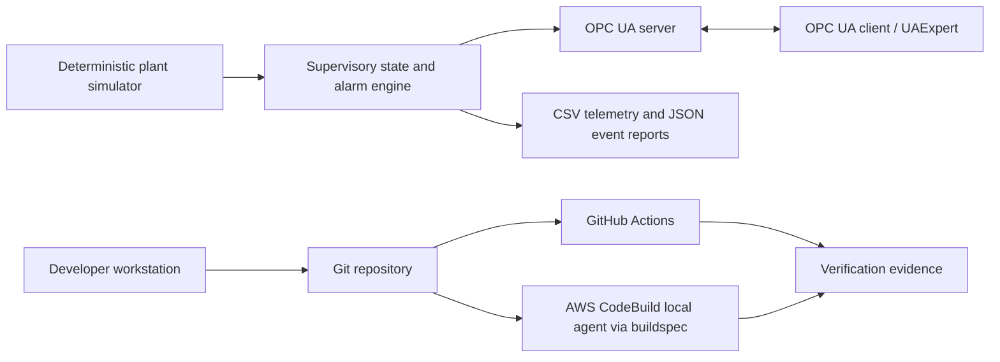
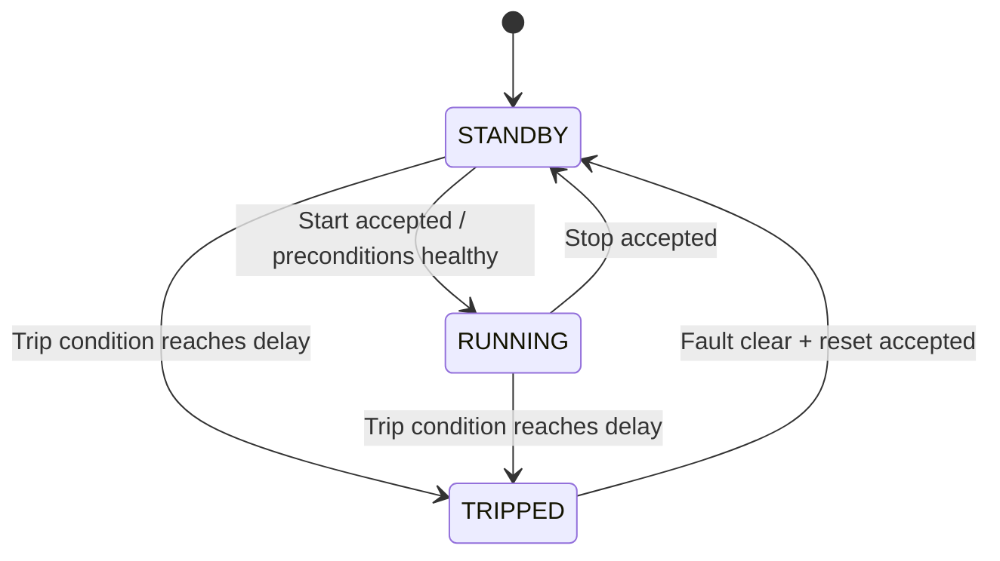

# System Architecture

## 1. Context

The demonstrator represents only the **supervisory software layer** around a simplified DC transmission link. The two converter stations are black-box endpoints that publish readiness and telemetry. The simulator is not a converter controller and does not model semiconductor switching or real-time control loops.

## 2. Functional components

| Component | Responsibility | In this lab |
|---|---|---|
| Plant model | Generate plausible synthetic measurements | DC voltage, current, power, cooling temperature, readiness flags |
| Supervisory engine | Track high-level operating state and process operator requests | STANDBY, RUNNING, TRIPPED; start/stop/setpoint/reset |
| Alarm/protection exercise | Evaluate synthetic conditions, delay and latch selected trips | Over/under-voltage, overcurrent, communication loss, bad quality, stale data, cooling |
| Protocol gateway | Expose structured data to a supervisory client | OPC UA endpoint bound to loopback only |
| Verification layer | Prove expected behavior | Unit tests, deterministic scenarios, manual OPC UA checks |
| Engineering workflow | Control changes and preserve evidence | Git, Issues, Pull Requests, CI, BuildSpec, versioned docs |

## 3. High-level lifecycle

1. **Requirements:** define what a simulated command, indication, alarm, and trip must do.
2. **Design:** document state transitions, signals, interfaces, assumptions, and test conditions.
3. **Implementation:** implement a small, isolated change on a feature branch.
4. **Review:** compare the change against its requirement and acceptance criteria.
5. **Verification:** run unit tests, fault scenarios, static checks, and protocol integration checks.
6. **Release baseline:** tag a tested revision and retain its configuration and reports.
7. **Virtual commissioning exercise:** follow a software-only checklist against the simulated endpoint; never connect to a real plant.

## 4. State model

A failed start request is rejected and leaves the state unchanged. A latched trip cannot be reset while its triggering condition remains active. A trip forces the simulated active power and DC current to zero in this intentionally simple model.

## 5. Data flow and timing

- Scenario files inject deterministic changes at specified simulation times.
- The engine advances in one-second or fractional-second test steps.
- The OPC UA gateway updates data nodes after each engine tick.
- A client writes a request node; the server consumes the request, validates it, clears the request bit, and exposes an acceptance flag and text acknowledgement.
- CSV output records the sequence of snapshots. JSON output records the scenario definition, event log, and final snapshot.

## 6. Important engineering distinction

An actual HVDC project may use real-time simulation facilities, proprietary platform tooling, project-specific configuration, hardware interfaces, and formal design/test gates. This training repository models the surrounding software-engineering discipline and selected supervisory behaviors only. It must not be presented as an implementation of MACH or a substitute for vendor training.
